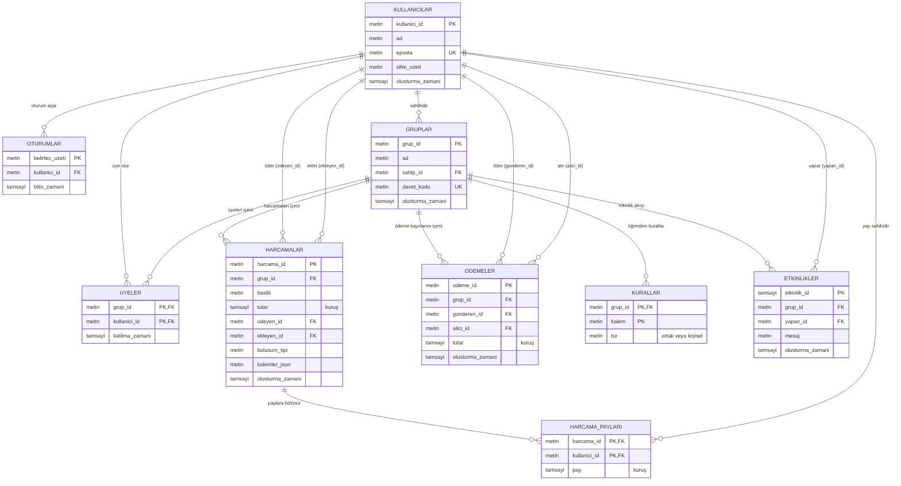
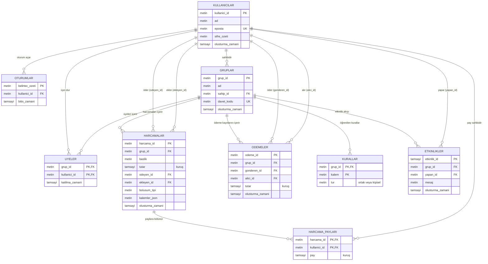

# Veritabanı ER Diyagramı

Ortak Gider uygulamasının veri modeli: 9 varlık, 15 ilişki. Şema `src/db.js` içinde kuruludur.

İngilizce (kodla birebir aynı adlar): [er-diagram-en.png](er-diagram-en.png)

## İlişkiler

- **1-N:** Bir grubun birçok harcaması, ödeme kaydı ve etkinliği olur. Bir harcama birçok paya bölünür.
- **N-N:** Kullanıcı ve grup arasındaki ilişki `UYELER` ara tablosuyla, harcama ve kullanıcı arasındaki ilişki `HARCAMA_PAYLARI` ara tablosuyla kurulur.
- Tüm tutarlar kuruş (tam sayı) olarak saklanır.

## Diyagram ve kod eşleşmesi

| Diyagram | Kod (`src/db.js`) |
| --- | --- |
| KULLANICILAR | `users` |
| OTURUMLAR | `sessions` |
| GRUPLAR | `groups` |
| UYELER | `members` |
| HARCAMALAR | `expenses` |
| HARCAMA_PAYLARI | `expense_splits` |
| ODEMELER | `settlements` |
| KURALLAR | `rules` |
| ETKINLIKLER | `activities` |

## Mermaid kaynağı

GitHub bu bloğu otomatik çizer. Aynı kaynak [er-diyagrami-tr.mmd](er-diyagrami-tr.mmd) dosyasındadır.

